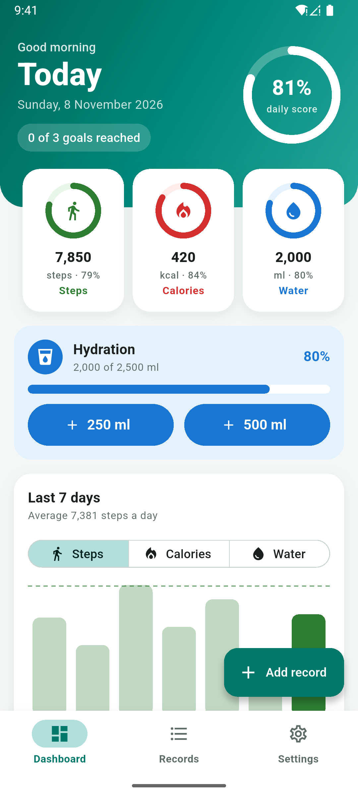
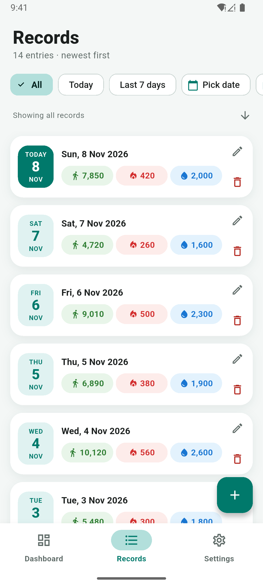
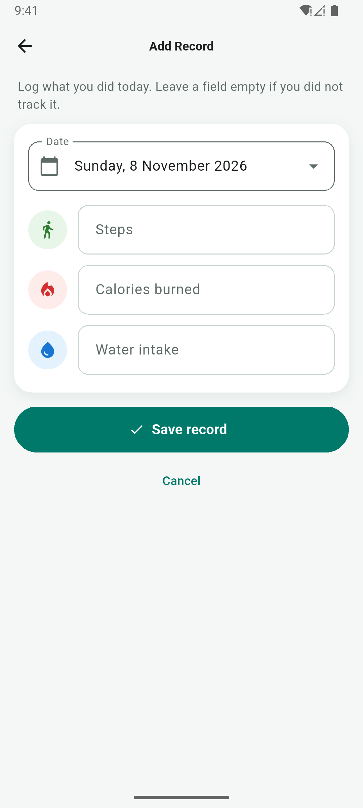
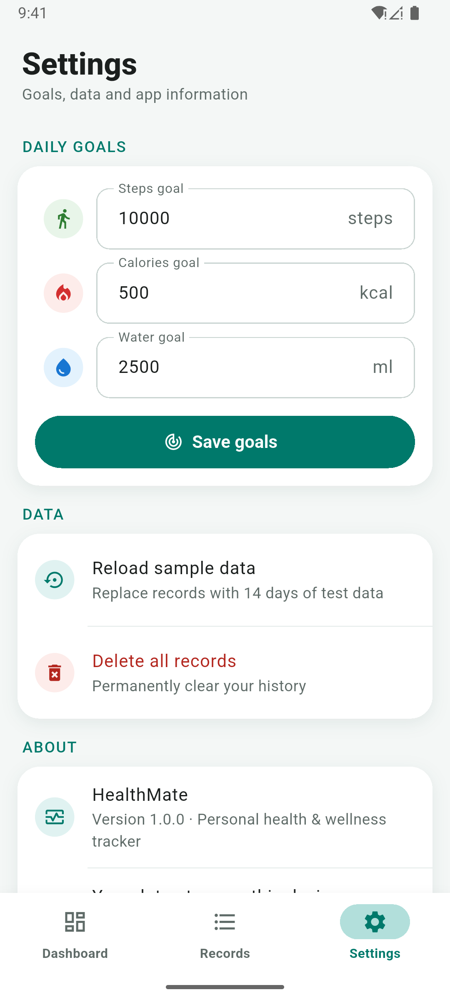
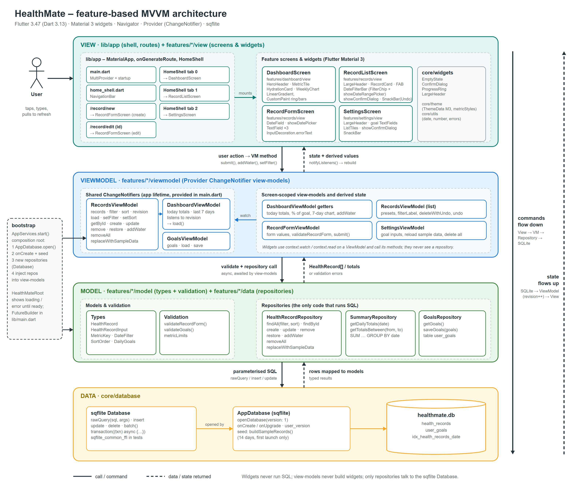
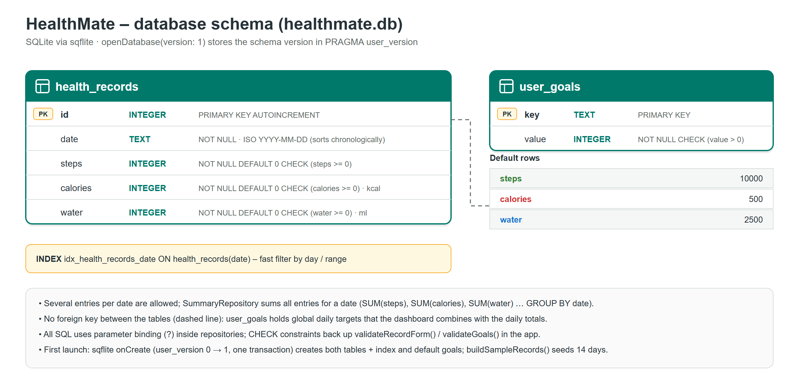
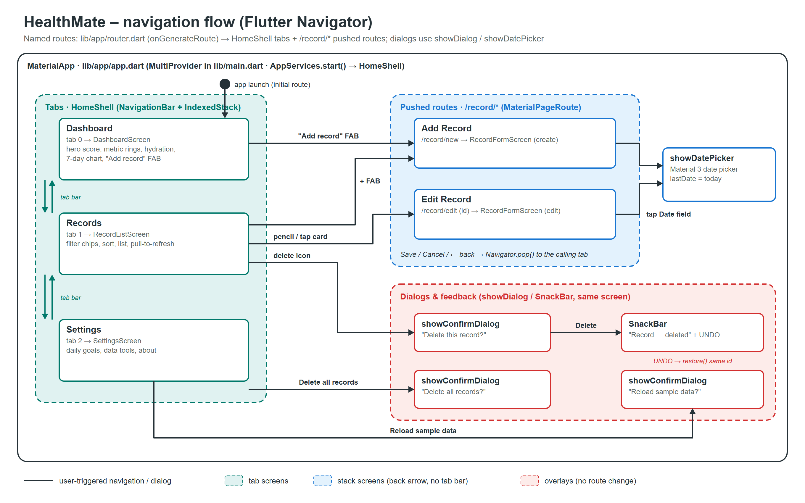

# HealthMate – Personal Health & Wellness Tracker

HealthMate is a Flutter app for Android and iOS. You log your daily **steps**, **calories burned** and **water intake**, look back over past days, search them by date, and follow your progress against daily goals on a dashboard. Everything is stored on the phone in SQLite through **sqflite**, and the screens get their state from **Provider** `ChangeNotifier` view-models.

Built for Kingston University **CI6330 Mobile Application Development – Coursework 1**.

| Dashboard | Records | Add record | Settings |
|---|---|---|---|
|  |  |  |  |

## Features

**Core requirements**
- **Add** a health entry (date, steps, calories in kcal, water in ml). Every field is validated with an inline error message.
- **View** every past record, newest or oldest first.
- **Update** or **delete** a record. Delete asks for confirmation and can be **undone** from the SnackBar.
- **Search and filter by date**: All, Today, Last 7 days, one picked date, or a date range (Material date pickers, future dates disabled).
- **Dashboard** with today's totals. Several entries on the same day are summed.

**Extra features**
- Daily goals (Settings), a progress ring per metric and an overall daily score.
- One-tap water logging (+250 ml / +500 ml).
- 7-day bar chart for steps, calories or water, with the goal drawn as a dashed line.
- 14 days of sample data on first launch, plus *Reload sample data* and *Delete all records* in Settings.
- A start-up screen with a clear error and a **Try again** button if the database cannot be opened.

## Tech stack

| Concern | Choice |
|---|---|
| Framework | Flutter 3.47 (Dart 3.13), Material 3 (`useMaterial3: true`) |
| Embedded database | `sqflite` (SQLite on the device), `path` |
| State management | `provider` – `ChangeNotifier` view-models (MVVM) |
| Formatting and locale | `intl` (`NumberFormat`), `flutter_localizations` (British English date pickers) |
| Charts and rings | Drawn with `CustomPaint` and plain widgets (no chart package) |
| Testing | `flutter_test` + `sqflite_common_ffi` (the real SQL runs on an in-memory SQLite database) |
| Icons | Material Icons; launcher icons generated with `flutter_launcher_icons` |

## Architecture (feature-based MVVM)



```
lib/
  main.dart              opens the database, then MultiProvider + MaterialApp
  app/                   app.dart (MaterialApp, start-up screen), bootstrap.dart (composition root),
                         router.dart (named routes), home_shell.dart (NavigationBar + IndexedStack)
  core/
    database/            app_database.dart (openDatabase, onCreate/onUpgrade migrations), sample_data.dart
    theme/               app_theme.dart (Material 3 theme, metric colours)
    utils/               local-date helpers, number formatting, error messages
    viewmodel/           SafeChangeNotifier base class
    widgets/             EmptyState, ConfirmDialog, ProgressRing, LargeHeader, IconCircle, ErrorBanner
  features/
    records/             model · data (repository) · viewmodel · view
    dashboard/           data (summary queries) · viewmodel · view
    settings/            model (goals) · data · viewmodel · view
test/                    unit tests (sqflite_common_ffi) and widget tests
```

- **View**: widgets only. They call `context.watch<SomeViewModel>()` to rebuild and call view-model methods on user actions.
- **ViewModel**: `ChangeNotifier` classes that hold screen state, run validation and call repositories. `RecordsViewModel` bumps a `revision` counter after every write; the `DashboardViewModel` listens to it and reloads its totals.
- **Model**: plain Dart classes, validation functions and repositories. Only repositories run SQL, always with bound `?` parameters.

## Database

`healthmate.db`, schema version 1 (stored by sqflite in `PRAGMA user_version`).

| Table | Columns |
|---|---|
| `health_records` | `id INTEGER PRIMARY KEY AUTOINCREMENT`, `date TEXT NOT NULL` (ISO `YYYY-MM-DD`, local time), `steps`, `calories`, `water` (`INTEGER NOT NULL DEFAULT 0 CHECK (>= 0)`) + index `idx_health_records_date` |
| `user_goals` | `key TEXT PRIMARY KEY`, `value INTEGER NOT NULL CHECK (value > 0)` – steps 10000, calories 500, water 2500 |

The tables, the index, the default goals and 14 days of sample data are created in `onCreate`, which sqflite runs once inside a transaction, so the sample data appears on the first launch only. Later schema changes go in `onUpgrade` as new numbered migrations.



## Getting started

Requirements: Flutter 3.47 or newer, the Android SDK, and an emulator or an Android phone with USB debugging.

```bash
flutter pub get
flutter run                 # debug build on the connected device
flutter analyze             # static analysis (no issues)
flutter test                # unit + widget tests
flutter build apk --release # build/app/outputs/flutter-apk/app-release.apk
```

Release signing: create `android/key.properties` (git-ignored) with `storeFile`, `storePassword`, `keyAlias` and `keyPassword`. Without that file the release build is signed with the debug key.

Unit tests use the operating system's SQLite through `sqflite_common_ffi` (see the `hooks:` section in `pubspec.yaml`), so no emulator is needed to run them.

## Testing

`flutter test` runs 51 tests:

- **Database**: schema and column types, the date index, seeding 14 days only once, default goals, rollback of a failed migration.
- **Repositories**: CRUD, `RecordNotFoundException`, filter by day and by range, sort order, undo restore with the same id, quick-add water, the `CHECK` constraint rejecting negatives, sample-data reset, daily totals that sum several entries and a zero-filled 7-day range.
- **Validation**: every rule and error message for records and goals.
- **View-models**: filter presets, delete and undo, load errors, dashboard score and goal progress, automatic reload after a write.
- **Widgets**: the Add Record form shows its errors on an empty submit; the Records list shows the TODAY badge and asks before deleting.

## Navigation



## Author

Minindu Alwis – CI6330 Mobile Application Development, Kingston University (ESOFT Metro Campus), 2026.
